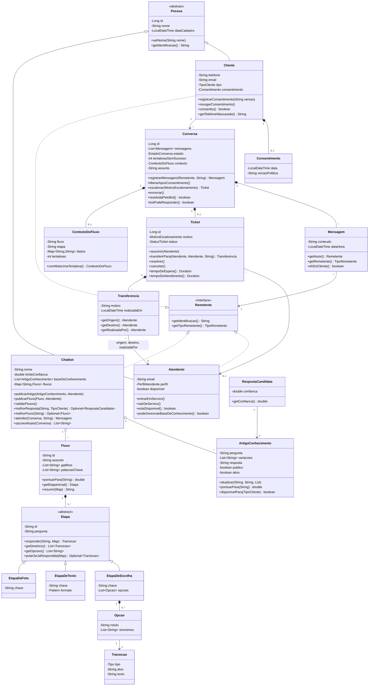

# Modelo de Classes de Entidade — Tino

**Projeto:** Tino — assistente de atendimento · **Cliente:** WXN · **Grupo:** 10
**Pacote:** `com.wxn.chatbot.dominio` · **19 classes** · **32 testes automatizados**

---

## 1. Entidades e responsabilidades

| Classe | Tipo | Responsabilidade |
|---|---|---|
| `Pessoa` | abstrata | Base de Cliente e Atendente: identidade, nome, data de cadastro |
| `Cliente` | entidade | Quem fala com o Tino pelo WhatsApp. Guarda telefone, tipo e consentimento |
| `Atendente` | entidade | Quem assume os casos escalonados. Tem perfil e disponibilidade |
| `Chatbot` | classe de domínio | O Tino. Busca na base, conduz os fluxos guiados e decide entre responder, conduzir e escalonar. Ainda não é gravado no banco: a base e os fluxos vivem em memória |
| `Conversa` | entidade (agregado) | Dona das mensagens e da máquina de estados |
| `Mensagem` | entidade imutável | Uma fala dentro de uma conversa |
| `Ticket` | entidade | O atendimento humano aberto no escalonamento |
| `Transferencia` | entidade imutável | Registro de um caso que mudou de mãos: origem, destino, quem decidiu, motivo e quando |
| `ArtigoConhecimento` | classe de domínio | Item da base: pergunta, variações, resposta. A tabela está desenhada no modelo de dados, mas ainda não existe |
| `Consentimento` | objeto de valor | Aceite do aviso de privacidade, com data e versão (LGPD) |
| `RespostaCandidata` | objeto de valor | Artigo encontrado + nota de confiança |
| `Relogio` | utilitário do domínio | Fonte única de "agora", no fuso de Recife. As entidades leem a hora daqui; nos testes, um relógio fixo deixa os carimbos de tempo previsíveis |
| `Remetente` | interface | Contrato de quem pode enviar mensagem |
| `TipoRemetente`, `TipoCliente`, `PerfilAtendente`, `EstadoConversa`, `MotivoEscalonamento`, `StatusTicket` | enums | Conjuntos fechados de valores, alguns com comportamento |
| `Fluxo` | classe de domínio | Um atendimento guiado sobre um assunto: como reconhecê-lo, as etapas e o que entra no resumo do atendente |
| `Etapa` | abstrata | Um passo de um fluxo: a pergunta e como ler a resposta |
| `EtapaDeEscolha`, `EtapaDeTexto`, `EtapaDeFoto` | classes de domínio | Os três jeitos de ler uma resposta: uma opção, um texto (com formato opcional) e uma foto |
| `Opcao` | objeto de valor | Uma resposta pronta, que vira botão, e para onde ela leva |
| `Transicao` | objeto de valor | O que vem depois de uma resposta: outra etapa, outro fluxo, repetir, concluir, encerrar ou passar para um atendente |
| `ContextoDoFluxo` | objeto de valor | Onde a conversa está num fluxo: fluxo, etapa, dados coletados e tentativas. Vai para o banco como JSON |
| `ContextoDoFluxoConverter` | conversor do JPA | Grava o contexto como JSON na coluna `conversa.contexto` e o lê de volta |
| `Linguagem` | utilitário do domínio | Como o Tino lê o que o cliente escreve: sem acento, sem pontuação, palavra por palavra |

---

## 2. Diagrama de classes



---

### O que vai para o banco

Das 29 classes, interfaces e enums do domínio, 7 são gravadas no banco: `Cliente`, `Atendente`, `Conversa`, `Mensagem`, `Ticket` e `Transferencia` (`@Entity`) e `Consentimento` (`@Embeddable`, na tabela `consentimento`). `Pessoa` é `@MappedSuperclass`: os campos dela vão para as tabelas de cliente e atendente. `ContextoDoFluxo` vai junto com a conversa, como JSON na coluna `conversa.contexto`, pelo `ContextoDoFluxoConverter`. `Chatbot`, `ArtigoConhecimento`, `RespostaCandidata` e os fluxos (`Fluxo`, as etapas, `Opcao` e `Transicao`) vivem em memória.

Conferido contra o código em 17/11/2026, e de novo em 27/11/2026, depois do atendimento guiado: todo atributo e método do diagrama existe na classe correspondente.

## 3. Relacionamentos e cardinalidade

| Relação | Cardinalidade | Tipo | Por quê |
|---|---|---|---|
| Cliente → Conversa | 1 para N | associação | Um cliente volta a conversar várias vezes |
| Conversa → Mensagem | 1 para N | **composição** | Mensagem não existe fora de uma conversa — o construtor é de pacote |
| Conversa → Ticket | 1 para 0..1 | **composição** | O ticket nasce do escalonamento e morre com a conversa |
| Ticket → Atendente | N para 0..1 | associação | Um ticket na fila ainda não tem atendente; por isso `Optional` |
| Ticket → Transferencia | 1 para N | **composição** | A transferência só existe dentro de um caso, e só `Ticket.transferirPara()` a cria (construtor de pacote) |
| Transferencia → Atendente | N para 1, três vezes | associação | Origem, destino e quem decidiu. Quem decidiu nem sempre é a origem: o gestor redistribui casos que não são dele |
| Cliente → Consentimento | 1 para 0..1 | **composição** | O aceite só faz sentido dentro do cliente, e pode ser revogado |
| Mensagem → Remetente | N para 1 | associação **polimórfica** | O autor pode ser Cliente, Chatbot ou Atendente |
| Chatbot → ArtigoConhecimento | 1 para N | **agregação** | O artigo existe no banco independente do bot |
| Pessoa → Cliente / Atendente | — | **herança** | Ambos são pessoas com identidade e nome |
| Chatbot → Fluxo | 1 para N | **agregação** | Os fluxos são conteúdo da WXN, publicados por um gestor, como os artigos |
| Fluxo → Etapa | 1 para 1..N | **composição** | Uma etapa só faz sentido dentro do seu fluxo |
| Etapa → EtapaDeEscolha / EtapaDeTexto / EtapaDeFoto | — | **herança** | Três jeitos de ler a resposta, com o mesmo contrato |
| Conversa → ContextoDoFluxo | 1 para 0..1 | **composição** | O estado de trabalho só existe dentro da conversa e some quando o caso vai para um atendente |

---

## 4. Requisitos de POO atendidos

| Conceito | Onde está no código |
|---|---|
| **Abstração** | `Pessoa` é abstrata e declara `getIdentificacao()` sem implementar. `Etapa` é abstrata e declara `responder()` e `getDestinos()` |
| **Herança** | `Cliente extends Pessoa`, `Atendente extends Pessoa`; `EtapaDeEscolha`, `EtapaDeTexto` e `EtapaDeFoto extends Etapa` |
| **Interface** | `Remetente`, implementada por três classes de hierarquias diferentes |
| **Polimorfismo** | `Mensagem` guarda um `Remetente`; cada tipo se identifica à sua maneira — cliente pelo telefone mascarado, atendente pelo perfil e nome, bot por nome e versão. O `Chatbot` conduz qualquer `Etapa` pelo mesmo contrato, e cada tipo lê a resposta do seu jeito: uma escolha, um texto, uma foto |
| **Encapsulamento** | Todos os atributos são `private`. Coleções saem por `Collections.unmodifiableList` ou `List.copyOf` |
| **Encapsulamento de criação** | Construtores de `Mensagem` e `Ticket` têm visibilidade de pacote: só `Conversa` os cria. O de `Transferencia` também: só `Ticket` a cria, depois de validar as regras |
| **Imutabilidade** | `RespostaCandidata`, `ContextoDoFluxo`, `Transicao`, `Opcao` e `Fluxo` são `final`, com campos `final`: cada passo de um fluxo cria um contexto novo. `Mensagem` e `Consentimento` não podem ser `final` porque o JPA precisa instanciá-las por reflexão; nelas a imutabilidade vem da ausência de setters |
| **Validação no construtor** | Nome vazio, telefone curto, e-mail malformado e confiança fora de 0–1 lançam `IllegalArgumentException` |
| **Invariantes de estado** | Transições inválidas lançam `IllegalStateException` — conversa encerrada não aceita mensagem, ticket encerrado não é assumido, atendente fora de serviço não assume caso, caso que não está em atendimento não é transferido |
| **Enum com comportamento** | `EstadoConversa.aceitaNovaMensagem()`, `PerfilAtendente.gerenciaBaseDeConhecimento()` |
| **Identidade** | Chave `@Id` gerada pelo banco em todas as entidades; dentro de uma sessão do JPA, cada linha corresponde a um único objeto |
| **Comportamento na entidade** | O modelo não é anêmico: `conversa.escalonar()`, `ticket.assumir()`, `ticket.transferirPara()`, `chatbot.atender()` carregam a regra, em vez de getters e setters expostos |

---

## 5. A regra central no código

O requisito "nunca inventar resposta" é a decisão de projeto mais importante, e está em `Chatbot.atender()`:

```java
Optional<RespostaCandidata> candidata =
        melhorResposta(perguntaDoCliente, conversa.getCliente().getTipo());

if (candidata.isPresent() && candidata.get().getConfianca() >= limiteConfianca) {
    conversa.reiniciarTentativas();
    return conversa.registrarMensagem(this, candidata.get().getArtigo().getResposta());
}

conversa.registrarTentativaSemSucesso();
MotivoEscalonamento motivo = conversa.esgotouTentativas()
        ? MotivoEscalonamento.TENTATIVAS_ESGOTADAS
        : MotivoEscalonamento.BAIXA_CONFIANCA;
conversa.escalonar(motivo);
return conversa.registrarMensagem(this, TEXTO_FALLBACK);
```

Abaixo do limite de confiança não existe caminho no código que devolva conteúdo da base. O fallback é estrutural, não uma recomendação de comportamento.

Com o atendimento guiado, o Tino também conduz o cliente pelos fluxos, mas a regra continua: ele só diz o que está escrito num artigo ou num fluxo. O que ele não reconhece abre o menu de assuntos, e depois de três respostas seguidas que não servem o caso vai para uma pessoa. Os detalhes estão em [fluxos-guiados.md](fluxos-guiados.md).

---

## 6. Divisão do trabalho

| Parte | Classes | Branch |
|---|---|---|
| Atores | `Pessoa`, `Cliente`, `Atendente`, `Consentimento`, `TipoCliente`, `PerfilAtendente` | `dominio-pessoas` |
| Mensagens e base de conhecimento | `Mensagem`, `ArtigoConhecimento`, `RespostaCandidata`, `TipoRemetente`, `MotivoEscalonamento`, `StatusTicket` | `mensagens-base-conhecimento` |
| Núcleo e integração | `Remetente`, `EstadoConversa`, `Conversa`, `Ticket`, `Chatbot`, testes | `main` |
| Atendimento guiado | `Fluxo`, `Etapa` e as três etapas, `Opcao`, `Transicao`, `ContextoDoFluxo`, `ContextoDoFluxoConverter`, `Linguagem` | `semana-17/fluxos-guiados` |

---

## 7. Verificação

```bash
.\mvnw.cmd "-Dtest=DominioTest,TransferenciaTest" test
```

```
Tests run: 32, Failures: 0, Errors: 0, Skipped: 0
BUILD SUCCESS
```

Os 21 testes cobrem: autorização do gestor, cliente criado a partir do WhatsApp sem e-mail, exigência de consentimento, registro e revogação do aceite, resposta pela base, fallback com escalonamento, handoff preservando histórico, recusa de atendente fora de serviço, encerramento do ticket, bloqueio de mensagem em conversa encerrada, coleção somente leitura, isolamento de artigo interno, artigo desativado, atualização da base pelo gestor, escolha do artigo de maior confiança, mascaramento de telefone, validação de dados inválidos, o fluxo completo do consentimento, a recusa do turno quando a conversa está com um humano e o bloqueio de reabertura de conversa encerrada.

O atendimento guiado tem os próprios testes, em `FluxoGuiadoTest` (25), descritos em [fluxos-guiados.md](fluxos-guiados.md).

Os 11 de `TransferenciaTest` cobrem a transferência: o caso muda de mãos e continua em atendimento, o tempo de espera não é zerado, o gestor transfere caso de outro e fica registrado como autor, atendente comum não transfere caso alheio, ticket na fila ou encerrado é recusado, destino igual ao atual ou fora de serviço é recusado, motivo obrigatório com até 280 caracteres, e transferências em sequência. As regras estão em [transferencia.md](transferencia.md).
