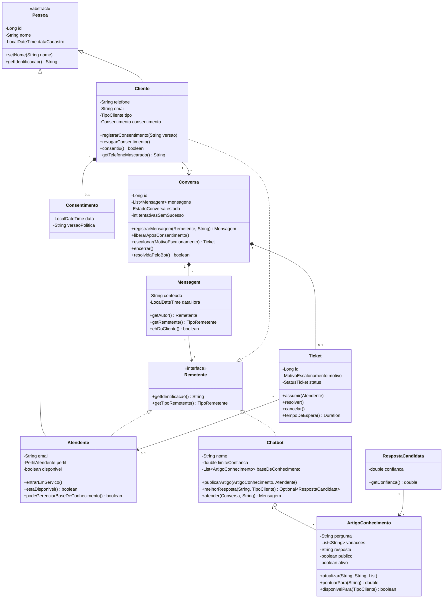

# Modelo de Classes de Entidade — Tino

**Projeto:** Tino — assistente de atendimento · **Cliente:** WXN · **Grupo:** 10
**Pacote:** `com.nxn.chatbot.dominio` · **17 classes** · **21 testes automatizados**

---

## 1. Entidades e responsabilidades

| Classe | Tipo | Responsabilidade |
|---|---|---|
| `Pessoa` | abstrata | Base de Cliente e Atendente: identidade, nome, data de cadastro |
| `Cliente` | entidade | Quem fala com o Tino pelo WhatsApp. Guarda telefone, tipo e consentimento |
| `Atendente` | entidade | Quem assume os casos escalonados. Tem perfil e disponibilidade |
| `Chatbot` | entidade | O Tino. Busca na base e decide entre responder e escalonar |
| `Conversa` | entidade (agregado) | Dona das mensagens e da máquina de estados |
| `Mensagem` | entidade imutável | Uma fala dentro de uma conversa |
| `Ticket` | entidade | O atendimento humano aberto no escalonamento |
| `ArtigoConhecimento` | entidade | Item da base: pergunta, variações, resposta |
| `Consentimento` | objeto de valor | Aceite do aviso de privacidade, com data e versão (LGPD) |
| `RespostaCandidata` | objeto de valor | Artigo encontrado + nota de confiança |
| `Remetente` | interface | Contrato de quem pode enviar mensagem |
| `TipoRemetente`, `TipoCliente`, `PerfilAtendente`, `EstadoConversa`, `MotivoEscalonamento`, `StatusTicket` | enums | Conjuntos fechados de valores, alguns com comportamento |

---

## 2. Diagrama de classes



---

## 3. Relacionamentos e cardinalidade

| Relação | Cardinalidade | Tipo | Por quê |
|---|---|---|---|
| Cliente → Conversa | 1 para N | associação | Um cliente volta a conversar várias vezes |
| Conversa → Mensagem | 1 para N | **composição** | Mensagem não existe fora de uma conversa — o construtor é de pacote |
| Conversa → Ticket | 1 para 0..1 | **composição** | O ticket nasce do escalonamento e morre com a conversa |
| Ticket → Atendente | N para 0..1 | associação | Um ticket na fila ainda não tem atendente; por isso `Optional` |
| Cliente → Consentimento | 1 para 0..1 | **composição** | O aceite só faz sentido dentro do cliente, e pode ser revogado |
| Mensagem → Remetente | N para 1 | associação **polimórfica** | O autor pode ser Cliente, Chatbot ou Atendente |
| Chatbot → ArtigoConhecimento | 1 para N | **agregação** | O artigo existe no banco independente do bot |
| Pessoa → Cliente / Atendente | — | **herança** | Ambos são pessoas com identidade e nome |

---

## 4. Requisitos de POO atendidos

| Conceito | Onde está no código |
|---|---|
| **Abstração** | `Pessoa` é abstrata e declara `getIdentificacao()` sem implementar |
| **Herança** | `Cliente extends Pessoa`, `Atendente extends Pessoa` |
| **Interface** | `Remetente`, implementada por três classes de hierarquias diferentes |
| **Polimorfismo** | `Mensagem` guarda um `Remetente`; cada tipo se identifica à sua maneira — cliente pelo telefone mascarado, atendente pelo perfil e nome, bot por nome e versão |
| **Encapsulamento** | Todos os atributos são `private`. Coleções saem por `Collections.unmodifiableList` ou `List.copyOf` |
| **Encapsulamento de criação** | Construtores de `Mensagem` e `Ticket` têm visibilidade de pacote: só `Conversa` os cria |
| **Imutabilidade** | `RespostaCandidata` é `final`, com campos `final`. `Mensagem` e `Consentimento` não podem ser `final` porque o JPA precisa instanciá-las por reflexão; nelas a imutabilidade vem da ausência de setters |
| **Validação no construtor** | Nome vazio, telefone curto, e-mail malformado e confiança fora de 0–1 lançam `IllegalArgumentException` |
| **Invariantes de estado** | Transições inválidas lançam `IllegalStateException` — conversa encerrada não aceita mensagem, ticket encerrado não é assumido, atendente fora de serviço não assume caso |
| **Enum com comportamento** | `EstadoConversa.aceitaNovaMensagem()`, `PerfilAtendente.gerenciaBaseDeConhecimento()` |
| **Identidade** | Chave `@Id` gerada pelo banco em todas as entidades; dentro de uma sessão do JPA, cada linha corresponde a um único objeto |
| **Comportamento na entidade** | O modelo não é anêmico: `conversa.escalonar()`, `ticket.assumir()`, `chatbot.atender()` carregam a regra, em vez de getters e setters expostos |

---

## 5. A regra central no código

O requisito "nunca inventar resposta" é a decisão de projeto mais importante, e está em `Chatbot.atender()`:

```java
Optional<RespostaCandidata> candidata =
        melhorResposta(perguntaDoCliente, conversa.getCliente().getTipo());

if (candidata.isPresent() && candidata.get().getConfianca() >= limiteConfianca) {
    conversa.reiniciarTentativas();
    return conversa.registrarMensagem(this, candidata.get().getArtigo().getResposta());
}

conversa.registrarTentativaSemSucesso();
MotivoEscalonamento motivo = conversa.esgotouTentativas()
        ? MotivoEscalonamento.TENTATIVAS_ESGOTADAS
        : MotivoEscalonamento.BAIXA_CONFIANCA;
conversa.escalonar(motivo);
return conversa.registrarMensagem(this, TEXTO_FALLBACK);
```

Abaixo do limite de confiança não existe caminho no código que devolva conteúdo da base. O fallback é estrutural, não uma recomendação de comportamento.

---

## 6. Divisão do trabalho

| Parte | Classes | Branch |
|---|---|---|
| Atores | `Pessoa`, `Cliente`, `Atendente`, `Consentimento`, `TipoCliente`, `PerfilAtendente` | `dominio-pessoas` |
| Mensagens e base de conhecimento | `Mensagem`, `ArtigoConhecimento`, `RespostaCandidata`, `TipoRemetente`, `MotivoEscalonamento`, `StatusTicket` | `mensagens-base-conhecimento` |
| Núcleo e integração | `Remetente`, `EstadoConversa`, `Conversa`, `Ticket`, `Chatbot`, testes | `main` |

---

## 7. Verificação

```bash
.\mvnw.cmd -Dtest=DominioTest test
```

```
Tests run: 21, Failures: 0, Errors: 0, Skipped: 0
BUILD SUCCESS
```

Os 21 testes cobrem: autorização do gestor, cliente criado a partir do WhatsApp sem e-mail, exigência de consentimento, registro e revogação do aceite, resposta pela base, fallback com escalonamento, handoff preservando histórico, recusa de atendente fora de serviço, encerramento do ticket, bloqueio de mensagem em conversa encerrada, coleção somente leitura, isolamento de artigo interno, artigo desativado, atualização da base pelo gestor, escolha do artigo de maior confiança, mascaramento de telefone, validação de dados inválidos, o fluxo completo do consentimento, a recusa do turno quando a conversa está com um humano e o bloqueio de reabertura de conversa encerrada.
